### Hey, I'm Aswin

I build **agentic AI systems**: multi-agent workflows, RAG pipelines, and the guardrails around them that make them safe to ship.
I run **[FRYHiTE](https://fryhite.in/)**, an AI agency where I design and ship these systems for clients.

```txt
currently   → building AI agents for clients at FRYHiTE
exploring   → fine-tuning open models (Hermes, LoRA/QLoRA) and serving them with vLLM
ask me      → agent architecture, RAG evals, n8n automations, CRM-integrated AI
```

---

## How I build agents



Every system I ship follows the same rules:

1. **Route before you reason.** Pick the right agent first. Don't make one giant prompt do everything.
2. **Ground every answer.** RAG with citations. No source means no claim.
3. **Guardrails go in before the first user sees it,** not after the first incident.
4. **Trace everything.** If I can't replay a run in LangSmith, it isn't production-ready.

<!--
## Results
Fill these in with REAL numbers before uncommenting. Don't guess. One true number beats five vague ones.

| What | Result |
|---|---|
| Client businesses running FRYHiTE agents | __ |
| Conversations / tasks handled by agents | __ / month |
| Hours of manual work saved for clients | __ / month |
| Lead response time | from __ to __ |
-->

---

## Stack

| Layer | Tools |
|---|---|
| **Agents & orchestration** | CrewAI · AutoGen · n8n · Claude Code |
| **Models** | OpenAI · Claude · Gemini · Hermes (Nous Research) · Ollama |
| **Fine-tuning & serving** | LoRA / QLoRA · vLLM |
| **Retrieval & evals** | RAG pipelines · vector DBs · LangSmith |
| **Product** | React · Vite · Tailwind · FastAPI |

---

## Activity

<p align="center">
  
  
</p>

---

## Let's talk

Building with agents, stuck on RAG quality, or want to collaborate on open-source tooling? Reach out.

<p>
  <a href="https://fryhite.in/"></a>
  <a href="https://linkedin.com/in/aswin-s-1a3026346"></a>
  <a href="https://x.com/aswinofcl"></a>
</p>
